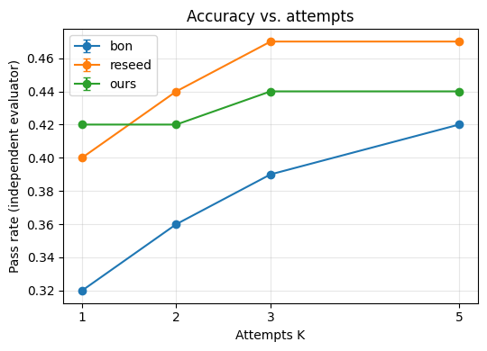
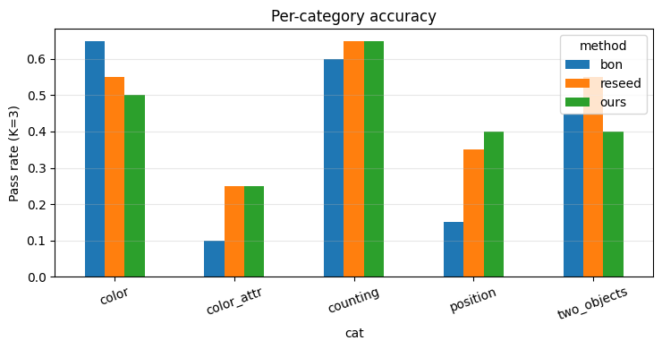
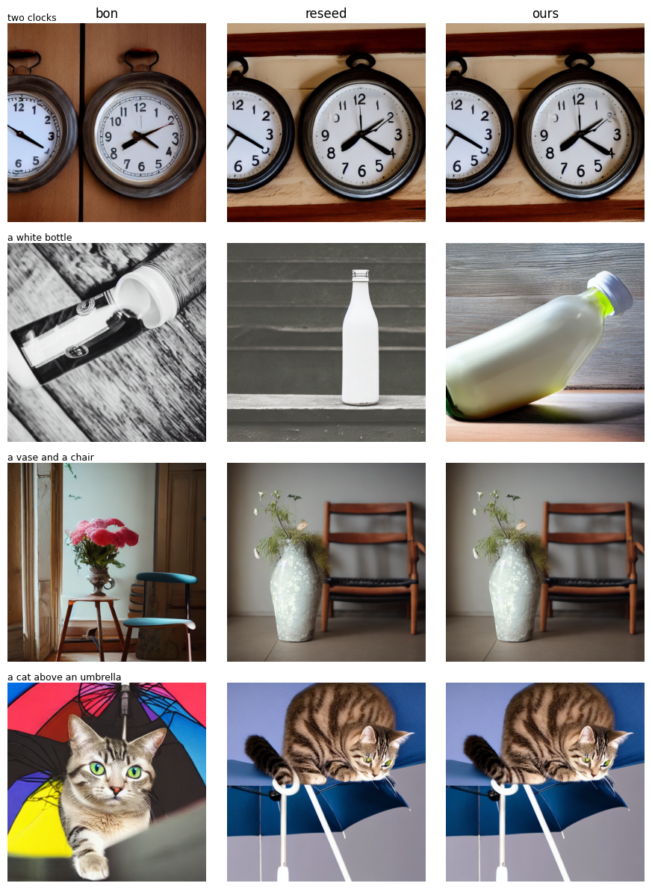

# Agentic Compositional Text-to-Image Generation

A training-free pipeline for compositional text-to-image generation with Stable Diffusion 1.5. An LLM planner turns a prompt into a structured plan (objects, counts, colors, relations), attention guidance places objects in a layout, and a detector-based verifier checks the result and drives a refinement loop. Everything runs on a single free-tier Colab T4 GPU.

This repo is an **empirical study**. It reports what worked, and also what did not (see [Findings](#findings) and [Limitations](#limitations)).

## Pipeline

```
prompt ──► Planner (Qwen2.5-1.5B) ──► plan: objects / counts / colors / relations
                                          │
                                          ▼
                              Layout (plan → bounding boxes)
                                          │
                                          ▼
          Generator: SD1.5 + cross-attention guidance (training-free)
                                          │
                                          ▼
          Verifier: OWLv2 (count, position) + CLIP-B/32 (color)
                       │ pass                        │ fail
                       ▼                             ▼
                  final image             refine and regenerate (up to K attempts)

Independent evaluator (DETR-R101 + CLIP-L/14) scores the final images against ground truth.
```

- **Planner:** Qwen2.5-1.5B-Instruct, few-shot JSON output, validated against the prompt.
- **Generator:** SD1.5 (fp16, DDIM, 30 steps, CFG 7.5). In the first 15 denoising steps, a loss on the cross-attention maps (16x16 and 32x32) pushes each object's tokens into its box. The latent is updated by the loss gradient.
- **Verifier (inside the loop):** OWLv2 counts objects and checks positions; CLIP-B/32 classifies the color of each detected crop.
- **Evaluator (outside the loop):** DETR-ResNet-101 + CLIP-L/14. It is a different model family from the verifier so that results are not circular.

## Compared methods

All methods get the same budget (up to K attempts) and the same stopping rule (stop when the verifier passes). The final image is the attempt with the best verifier score.

| Method | Layout guidance | Next attempt |
|---|---|---|
| `bon` | no | new random seed (best-of-N) |
| `reseed` | yes | new random seed |
| `ours` | yes | **same seed**; increase guidance weight only for the objects that failed. The increase scales with failure severity, and color failures also bind the color token to the object's box. |

## Setup

- 100 prompts in 5 categories (20 each): `counting`, `color`, `two_objects`, `position`, `color_attr`. Prompts are generated from 12 COCO object classes and 9 colors (GenEval-style, **not** the official GenEval set).
- Planner accuracy against ground truth: 1.00 (100/100), 0 invalid plans.
- Metric: a prompt passes only if **all** its conditions are satisfied (count, color, relation), judged by the independent evaluator.
- Results below use **1 seed (seed 0)**.

## Results

### Accuracy vs. number of attempts K

| Method | K=1 | K=2 | K=3 | K=5 |
|---|---|---|---|---|
| bon | 0.32 | 0.36 | 0.39 | 0.42 |
| reseed | 0.40 | 0.44 | 0.47 | 0.47 |
| ours | 0.42 | 0.42 | 0.44 | 0.44 |



### Per category (K=3)

| Method | color | color_attr | counting | position | two_objects |
|---|---|---|---|---|---|
| bon | 0.65 | 0.10 | 0.60 | 0.15 | 0.45 |
| reseed | 0.55 | 0.25 | 0.65 | 0.35 | 0.55 |
| ours | 0.50 | 0.25 | 0.65 | 0.40 | 0.40 |



### Cost (average per prompt)

| Method | Generations | Time (s) |
|---|---|---|
| bon | 2.77 | 16.5 |
| reseed | 2.23 | 19.7 |
| ours | 2.40 | 21.2 |

### Paired comparison (K=3, per prompt)

| Comparison | only A passes | only B passes | both pass | neither |
|---|---|---|---|---|
| ours vs reseed | 6 | 9 | 38 | 47 |
| ours vs bon | 22 | 17 | 22 | 39 |

### Verifier reliability

Verifier decision vs. independent evaluator over all attempts (counts):

| | evaluator fail | evaluator pass |
|---|---|---|
| verifier fail | 471 | 44 |
| verifier pass | 105 | 120 |

Verifier precision is about 53% (120/225) and recall about 73% (120/164).

### Qualitative examples

Prompts where `ours` passes the independent evaluator and `bon` does not (columns: bon, reseed, ours).



## Findings

1. **Layout guidance helps, mainly for spatial relations.** Position accuracy rises from 0.15 (`bon`) to 0.35-0.40 (`reseed`/`ours`) at K=3, and first-attempt accuracy rises from 0.32 to 0.40-0.42.
2. **Targeted refinement did not beat re-seeding in this study.** At K=3, `ours` reaches 0.44 vs. 0.47 for `reseed`, and in the paired comparison `reseed` wins slightly more often (9 vs. 6). With one seed and 100 prompts this difference is not conclusive, but there is no evidence that `ours` is better than `reseed`.
3. **The in-loop verifier is a bottleneck.** Only about half of its "pass" decisions agree with the independent evaluator. Refinement that depends on its feedback is limited by this noise.
4. **`color_attr` (two objects with two colors) is hard for all methods** (0.10-0.25).

## Limitations

- One seed only; no standard deviations yet.
- 100 self-generated prompts from 12 object classes, not the official GenEval or T2I-CompBench benchmarks.
- The evaluator itself is imperfect (DETR threshold 0.7, CLIP color classification), so absolute numbers are noisy and mainly useful for comparing methods.
- Guidance hyperparameters (`alpha`, number of guided steps, boost step) were not tuned.
- SD1.5 at 512x512 only.

## Reproduce

1. Open the notebook in Google Colab and select a **T4 GPU** runtime.
2. Run the cells in order (install, setup, prompts, planner, layout, generator, verifier, experiment, evaluation). Results are cached to Google Drive and the experiment cell resumes after a disconnect.
3. Run the evaluation cell last. It unloads Stable Diffusion from the GPU to load the evaluator.

```
agentic-compositional-t2i/
├── README.md
├── agentic_refinement.ipynb   # full pipeline + experiments
├── requirements.txt
└── results/
    ├── fig_accuracy_vs_K.png
    ├── fig_per_category.png
    ├── fig_qualitative.png
    └── eval_v2.csv
```

## Models used

Stable Diffusion 1.5, Qwen2.5-1.5B-Instruct, OWLv2 (base, ensemble), CLIP ViT-B/32 and ViT-L/14, DETR-ResNet-101. The attention-guidance idea is related to training-free layout control methods such as Attend-and-Excite and BoxDiff; this repo is an independent, simplified implementation and has not been compared against them.

## Future work

- Improve verifier reliability (confidence calibration, multi-detector agreement).
- Run more seeds and the official GenEval prompts.
- Ablations: adaptive vs. fixed boost, color binding on/off, guidance hyperparameters.

## License

MIT (code). Model weights follow their own licenses.
